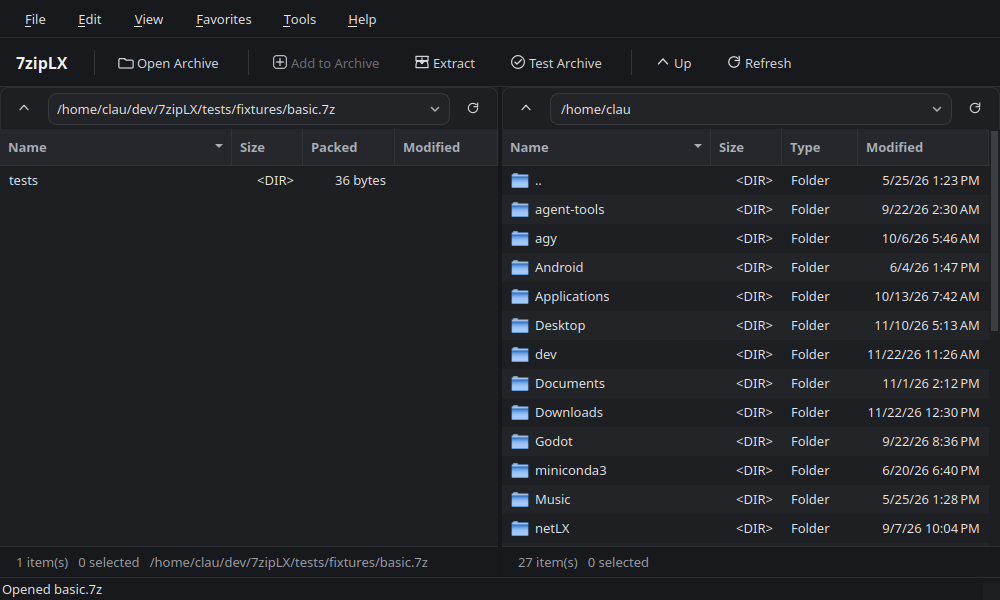
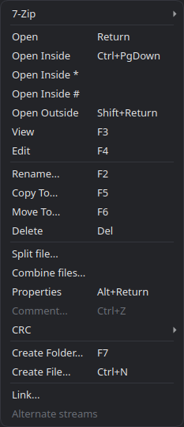
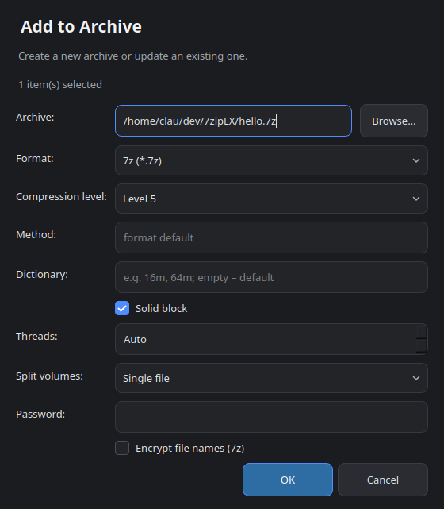

<p align="center">
  
</p>

<h1 align="center">7zipLX</h1>

<p align="center">
  A native Linux GUI for 7-Zip, built with Qt 6 and the portable 7-Zip 26.06 engine.
</p>

<p align="center">
  
  
  
  
</p>

7zipLX is a two-panel Linux archive manager in the spirit of the classic 7-Zip
File Manager. The 7-Zip 26.06 engine is compiled directly into the app — no Wine
wrapper and no external `7z` process.

Project repository: [github.com/ClaudiuJitea/7zipLX](https://github.com/ClaudiuJitea/7zipLX)



## Highlights

- **Native dual-pane UI** — Qt 6 Widgets, dark Fusion-based theme, active-pane
  highlighting and `Tab` switching.
- **Real 7-Zip engine** — formats, codecs, crypto and archive editing come from
  7-Zip 26.06 itself.
- **Practical drag and drop** — multi-selection preserved, folder-row targets,
  local ↔ archive and archive ↔ archive transfers; `Shift` moves, plain/`Ctrl`
  copies.
- **Cross-pane clipboard** — cut/copy/paste between local folders and archives;
  a stale archive clipboard reopens its source archive.
- **Nested archives** — browse and edit them. Changes are written back to the
  parent archive recursively; 7z/ZIP/TAR are updated in place, GZip/BZip2/XZ
  parents are rebuilt atomically.
- **Full archive toolset** — extract, test, create, update, rename, delete,
  comments, encryption, hashes, split/combine and benchmarks.
- **Linux integration** — desktop entry, AppStream metadata, icons, optional
  external `7z.so` module, `.deb` and AppImage packages.

## Features

### Dual-pane workflow

- Multi-item drag and drop with `Ctrl+A` / `Ctrl` / `Shift` selection.
- Local ↔ local, local ↔ archive and archive ↔ archive transfers.
- Drop on a folder row to choose the destination; archive folder rows add inside
  that archive folder.
- `F5` / `F6` copy or move to the other panel.
- Clipboard cut/copy/paste across panes and archives.
- Active panel border/status, selected size display and persistent selections.
- Selection-preserving refreshes, sorting and archive updates.

### Archives

- Open 7z, ZIP, TAR, GZip, BZip2, XZ, RAR (read-only), ISO, WIM, CAB, ARJ, LZH,
  Zstandard and the other formats compiled into the engine.
- Browse archive folders, nested archives and a flat all-items view.
- Extract selected items or everything; full/current/no/absolute path modes and
  ask/overwrite/skip/rename conflict handling.
- Create 7z, ZIP, TAR and other writable formats; update existing archives.
- Rename, delete, create folders/files and edit comments where supported.
- Nested-archive write-back for update-capable parents; split-volume and
  read-only outer formats are rejected with an explanation before editing.
- Archive-to-archive copy through temporary extraction.

### Security and integrity

- Password-protected archives and encrypted 7z headers.
- Password prompting before listing/open/extract; wrong-password and cancel
  handling.
- Archive testing and CRC inspection.
- Hashes: CRC32, CRC64, MD5, SHA-1, SHA-256, SHA-512, SHA3-256, BLAKE2sp,
  XXH64 and other engine methods.

### Local file manager and tools

- Mount view, favorites and persisted window/panel settings.
- Create, rename, copy, move, delete and link files/folders.
- External viewer, editor and diff commands.
- ZIP item comments.
- Split/combine files and LZMA/LZMA2 benchmark.
- Drag and drop from desktop file managers.

### Dialogs and desktop integration

- Aligned forms with right-aligned labels and consistent control heights.
- Themed message, confirmation, overwrite and input dialogs across the app.
- Modern progress, hash, options, benchmark and about dialogs.
- Dark theme, monochrome toolbar icons and compact tables.
- XDG desktop entry, AppStream metadata and hicolor icons (16–256 px).
- Optional external codec/format module and Debian/AppImage build recipes.

Windows-only features such as Explorer integration, NTFS alternate streams,
drive letters, PE SFX and registry integration are intentionally not ported.

## Screenshots

| Local files | Archive contents | Add to Archive |
| :---: | :---: | :---: |
|  |  |  |

More screenshots are in [`docs/screenshots`](docs/screenshots).

## Install

Prebuilt artifacts are on the
[GitHub Releases page](https://github.com/ClaudiuJitea/7zipLX/releases).

### Debian / Ubuntu

```bash
sudo apt install ./dist/7ziplx_0.4.0-1_amd64.deb
```

Installs the app, shared engine, desktop entry, icons, man page and notices.
The package targets the build host's distribution (currently Ubuntu 26.04 amd64).

### AppImage

```bash
chmod +x dist/7zipLX-0.4.0-x86_64.AppImage
./dist/7zipLX-0.4.0-x86_64.AppImage
```

Bundles Qt 6, `lib7zcore.so`, `7z.so`, platform plugins and the app icon.
Requires glibc 2.34 or newer. `dist/SHA256SUMS` contains both checksums; `dist/`
is ignored by Git and is used for release assets.

## Build from source

Requirements: CMake 3.24+, Qt 6.5+ Widgets, a C++20 compiler, Ninja or Make,
and `pthread`/`dl`. Building the optional external codec module also needs
`patch`, `sed` and `make`; fetching 7-Zip needs `curl`/`wget` and `tar`.

The 7-Zip source is **not vendored**. Fetch the pinned 26.06 tree once:

```bash
./scripts/fetch-7zip.sh
```

Then build and run:

```bash
cmake --preset release
cmake --build --preset release -j"$(nproc)"
./build-release/7ziplx
./build-release/7ziplx path/to/archive.7z
```

The fetch script extracts to `7z2606-src/` (ignored by Git). Use an existing
tree with `-DSEVENZIP_SOURCE_DIR=/path/to/7z2606-src`.

Build packages:

```bash
./scripts/build-deb.sh
./scripts/build-appimage.sh
```

Artifacts go to `dist/`. The AppImage build downloads linuxdeploy, its Qt plugin
and appimagetool into the ignored `build-appimage/tools/`.

## Architecture

```
Qt 6 Widgets UI        MainWindow, FilePanel/FileView, models, dialogs
        │
Backend adapter        ArchiveSession, CompressOperation, ArchiveWriteBack,
                       HashOperation, ProgressState, PromptDispatcher
        │
Reused 7-Zip 26.06     codecs, Archive, Compress, Crypto, UI/Common, UI/Agent
        │
POSIX subset of CPP/Windows
```

- `7zcore` — shared library with the reused 7-Zip translation units.
- `7ziplx_backend` — 7-Zip adapter, operations, prompts and write-back logic.
- `7ziplx_ui` — Qt Widgets UI, theme and resources.
- `7ziplx` — application executable.
- `7z.so` — optional external codec/format module loaded next to the executable.

Archive operations run in worker threads. Password and overwrite prompts are
marshalled back to the GUI thread; the UI never calls 7-Zip directly.

## Keyboard shortcuts

| Action | Shortcut |
|---|---|
| Open archive | `Ctrl+O` |
| Extract / test | `Ctrl+E` / `Ctrl+T` |
| Add to archive | `Alt+A` |
| Copy / move to other panel | `F5` / `F6` |
| View / edit | `F3` / `F4` |
| Rename / delete | `F2` / `Del` |
| Create folder / file | `F7` / `Ctrl+N` |
| Up one level | `Backspace` |
| Switch active panel | `Tab` / `Shift+Tab` |
| Focus path bar | `Ctrl+L` |
| Select all / invert | `Ctrl+A` / `Ctrl+I` |
| Cut / copy / paste | `Ctrl+X` / `Ctrl+C` / `Ctrl+V` |
| Refresh / hash | `Ctrl+R` / `Ctrl+H` |
| Close archive | `Ctrl+W` |

## Known limitations

- Nested-archive write-back is unavailable for split-volume containers
  (`.001`, `.002`, …) and read-only outer formats; the app explains this before
  editing.
- Moving items *into* a nested archive is blocked; copy them instead.
- Flat view cannot write back nested archives; switch to normal view first.
- Translation catalogs are not bundled; the loader and language selector are
  ready for `7ziplx_<code>.qm` files.
- Archive comments are limited to formats exposing
  `IFolderOperations::SetProperty` (currently ZIP items).
- Nested browsing and archive-to-archive transfers use temporary disk space.
- External editors open a temporary copy of archive items; edits are not written
  back automatically.
- Third-party `7z.so` plugins must match the 7-Zip 26.06 ABI.
- Very large local directories load synchronously.

## Documentation and license

- [User guide](docs/USER-GUIDE.md)
- [Build and packaging notes](docs/BUILD.md)
- [Packaging recipes](packaging/README.md)
- [Third-party notices](NOTICE.md) · [License texts](LICENSES/)

7-Zip is primarily LGPL-2.1-or-later, with unRAR restrictions on RAR
decompression and BSD-licensed components. Qt 6 is available under
LGPLv3/GPL/commercial terms. `7zcore` is built as a shared library to make LGPL
relinking practical. Review [`NOTICE.md`](NOTICE.md) and [`LICENSES/`](LICENSES/)
before distribution.
