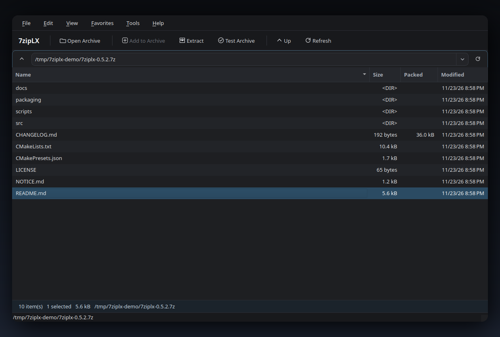
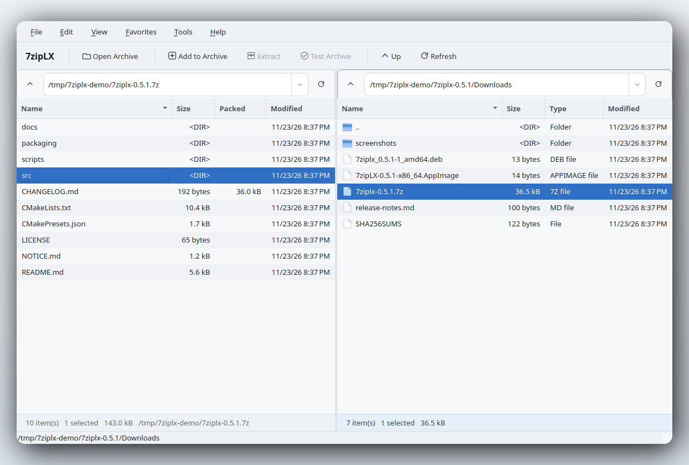
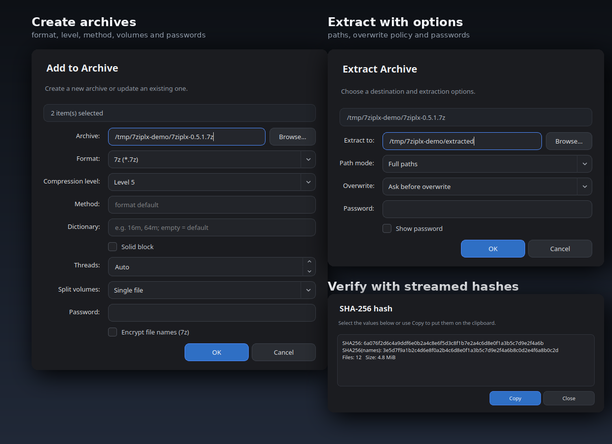
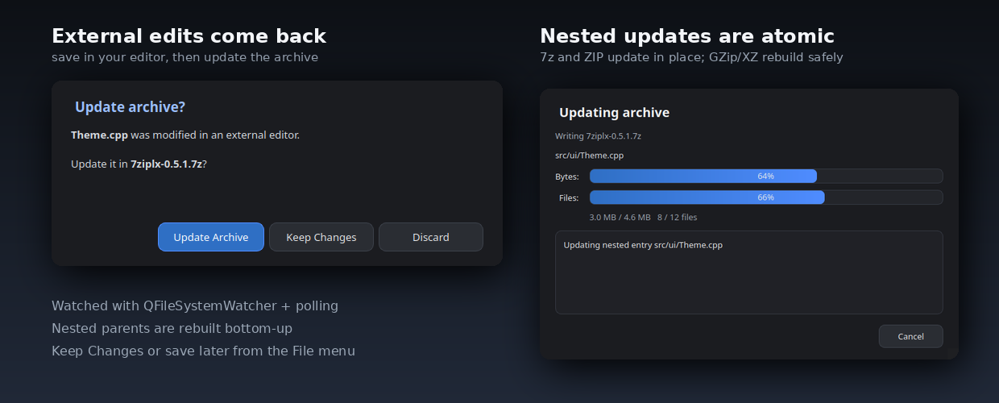
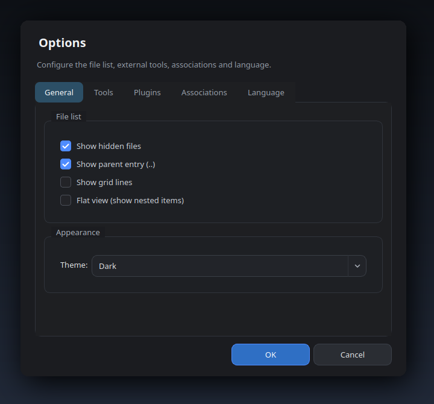

<p align="center">
  
</p>

<h1 align="center">7zipLX</h1>

<p align="center">
  Native Qt 6 archive manager for Linux, built directly on the 7-Zip 26.06 engine.
</p>

<p align="center">
  
  
  
  
</p>



7zipLX is a native Linux file manager for archives. It opens with **one pane**,
adds a second on `F9`, and can write files edited in external applications back
into 7z, ZIP, TAR, GZip, BZip2 and XZ archives. No Wine and no external `7z`
process — the engine is compiled into the app.

## Highlights

- **Single-pane first.** A clean one-pane view by default; `View ▸ Two Panels`
  (`F9`) shows a second pane when you need to copy or compare.
- **Edit outside, save inside.** `F4` opens a watched temporary copy. Save in
  your editor and 7zipLX offers **Update archive?**, including nested archives
  and atomic GZip/XZ parent rebuilds.
- **Hashes without extraction.** Archive items are streamed through the 7-Zip
  hashers in memory, saving both time and temporary disk space.
- **Responsive with big folders.** Local directory scans run in the background
  and fill the list in batches; long archive operations show progress and can be
  canceled.
- **Archives that behave like files.** Browse nested archives, drag between
  local folders and archives, use cut/copy/paste, extract, test, create, rename,
  delete, comment, split and benchmark.
- **Native Linux integration.** System/light/dark themes, desktop actions,
  Nautilus/Nemo/Dolphin/Thunar actions, CLI mode, `.deb`, AppImage and Flatpak
  recipes.

## See it

**One pane or two — remembered between sessions.** `F5`/`F6` reveal the second
pane automatically in single-pane mode.



**Create, extract and verify.** Full path modes, overwrite policies, volumes,
passwords and streamed hashes.



**Edit outside the app, update inside the archive.** The edited copy is watched;
nested parent archives are rebuilt bottom-up and atomically.



## Themes and settings

| Appearance | Also in Options |
| :---: | --- |
|  | Follow the system theme, or choose **Light** or **Dark**. The same dialog controls hidden files, grid/flat view, viewer/editor/diff commands, plugin status, MIME associations and language. Settings persist next to the window layout and panel paths. |

## Install

Prebuilt assets are on the
[GitHub Releases page](https://github.com/ClaudiuJitea/7zipLX/releases).

```bash
# Debian / Ubuntu
sudo apt install ./7ziplx_0.5.3-1_amd64.deb

# AppImage
chmod +x 7zipLX-0.5.3-x86_64.AppImage
./7zipLX-0.5.3-x86_64.AppImage
```

Python 3 and `python3-pil` are only needed to regenerate the README images.

File-manager integration and the Flatpak manifest:

```bash
./scripts/install-file-manager-actions.sh
flatpak-builder --user --install --force-clean build-flatpak \
  packaging/flatpak/io.github.claudiujitea.7zipLX.yml
```

## CLI

```bash
7ziplx --extract-here archive.7z          # into the archive's folder
7ziplx --extract-to-folder a.zip b.7z     # each into its own folder
7ziplx --extract-to /path/to/output archive.zip
7ziplx --extract archive.7z               # Extract dialog
7ziplx --test archive.7z
7ziplx --compress a.txt b.txt             # one archive: <folder>.7z
7ziplx --compress --format zip photos/    # photos.zip
7ziplx --compress-to output.7z file1 file2
7ziplx --add file1 folder2                # Add to Archive dialog
```

CLI modes show the normal progress dialog, support passwords and overwrite
prompts, and exit without opening the main window. They power the right-click
**7-Zip** menu on the GNOME desktop (Scripts → 7zipLX), in GNOME Files (with
`python3-nautilus`), Dolphin, Nemo and Thunar — see the user guide.

## Build and test

Requirements: CMake 3.24+, Qt 6.4+ Widgets, a C++20 compiler, Ninja/Make,
`pthread`/`dl`, plus `patch`, `sed` and `make` for the optional `7z.so` module.

```bash
./scripts/fetch-7zip.sh
cmake --preset release
cmake --build --preset release -j"$(nproc)"
./build-release/7ziplx

# Tests
ctest --test-dir build-release --output-on-failure

# ASan + UBSan
cmake --preset debug-asan
cmake --build --preset debug-asan -j"$(nproc)"
ctest --test-dir build-asan --output-on-failure

# x86-64 assembly (asmc/jwasm/uasm)
cmake --preset release-asm -DSEVENZIP_ASM_COMPILER="$(command -v asmc)"
cmake --build --preset release-asm -j"$(nproc)"
```

The test suite covers create/extract round trips, passwords, overwrite and
cancel paths, nested and single-file write-back, streamed hashing, local
copy/move and archive path traversal (`../`, absolute paths, symlinks). CI runs
the ASan suite, the assembly build, and publishes `.deb`/AppImage assets on
version tags.

Regenerate the screenshots:

```bash
cmake -S . -B build-release -G Ninja -DCMAKE_BUILD_TYPE=Release -DBUILD_SCREENSHOTS=ON
cmake --build build-release -j"$(nproc)"
QT_QPA_PLATFORM=offscreen ./build-release/7ziplx-screenshots docs/screenshots-raw
python3 tools/compose_screenshots.py docs/screenshots-raw docs/screenshots
```

## Documentation

- [User guide](docs/USER-GUIDE.md)
- [Build and packaging notes](docs/BUILD.md)
- [Packaging recipes](packaging/README.md)
- [Third-party notices](NOTICE.md) · [License texts](LICENSES/)

7-Zip is primarily LGPL-2.1-or-later, with unRAR restrictions on RAR
decompression and BSD-licensed components. Qt 6 is available under
LGPLv3/GPL/commercial terms. `7zcore` is built as a shared library to make LGPL
relinking practical. Review [`NOTICE.md`](NOTICE.md) before distribution.
