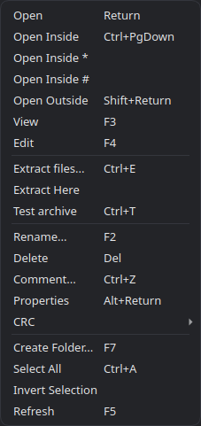
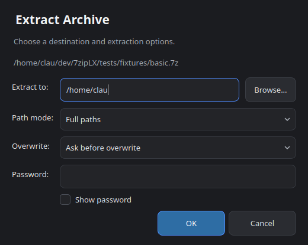
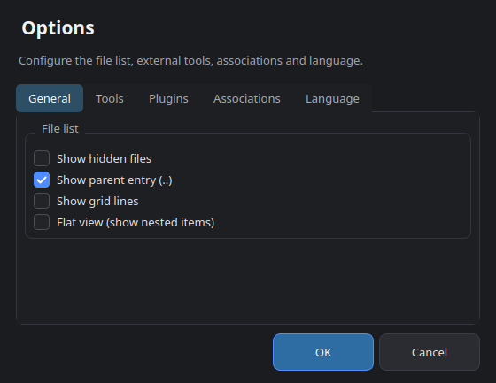

<p align="center">
  
</p>

<h1 align="center">7zipLX</h1>

<p align="center">
  A native Linux GUI for 7-Zip, built with Qt 6 and the portable 7-Zip 26.06 engine.
</p>

<p align="center">
  
  
  
  
</p>

7zipLX is a two-panel Linux archive manager in the spirit of the classic
7-Zip File Manager. It is a native Qt 6 application — not a Wine wrapper or a
front-end to the `7z` command-line tool. The archive engine is compiled directly
into the app from the portable 7-Zip 26.06 sources.

It can browse, extract, create and edit archives, handle encrypted files and
encrypted headers, compare files, calculate hashes, split/combine files and
manage local files in a familiar dual-pane layout.

Project repository: [github.com/ClaudiuJitea/7zipLX](https://github.com/ClaudiuJitea/7zipLX)


## Highlights

- **Native Linux UI** — Qt 6 Widgets with a polished dark theme.
- **Real 7-Zip engine** — archive formats, codecs, crypto and editing come from
  7-Zip 26.06, not an external CLI process.
- **Two-panel workflow** — drag and drop or use `F5` / `F6` to copy and move
  between local folders and archives, with multi-selection preserved.
- **Full archive operations** — open, browse, extract, test, create, update,
  rename, delete and hash archive items.
- **Encryption support** — password-protected archives and encrypted 7z headers.
- **Familiar context menus** — 7-Zip File Manager-style menus for local files
  and archive contents.
- **Linux desktop integration** — desktop entry, AppStream metadata, hicolor
  icons, XDG associations and installable `.deb` / AppImage packages.

## Screenshots

### Browse local files and archives side by side

The left panel can show an archive while the right panel browses the local
filesystem. Drag and drop, copy/move and archive editing work across both panels.


### Dual-pane drag and drop

- Drag a complete multi-selection (`Ctrl+A`, `Ctrl`/`Shift`-click) without losing
  the rows you started the drag from.
- Drop on a folder row to use that folder as the destination; archive folder
  rows add items inside that archive folder.
- Plain drag or `Ctrl` copies; `Shift` moves. Local, archive and mixed
  local/archive transfers are supported in both directions.
- `Tab` / `Shift+Tab` switch the active panel. The active panel has a distinct
  border and status bar.
- `Ctrl+X` / `Ctrl+C` / `Ctrl+V` work across panels and archives, including a
  clipboard taken from an archive panel that has since been closed.

### Right-click menus

The local-files menu includes the **7-Zip** submenu, open/extract/test actions,
file operations, hashes, split/combine and creation actions. The archive panel
adds extraction, testing, comments and in-archive editing.

| Local files | Archive contents |
| :---: | :---: |
|  |  |

### Create and extract archives

Compression supports format selection, levels, methods, dictionaries, solid
blocks, thread count, split volumes and passwords. Extraction supports full or
flat paths, overwrite policies and password entry.

| Add to Archive | Extract Archive |
| :---: | :---: |
|  |  |

### Configure the workspace

Options cover the file list, external viewer/editor/diff tools, plugin status,
MIME associations and language selection.

<p align="center">
  
</p>

## Features

### Archive browsing

- Open 7z, ZIP, TAR, GZip, BZip2, XZ, RAR (read-only), ISO, WIM, CAB, ARJ, LZH,
  Zstandard and the other formats compiled into the 7-Zip engine.
- Browse folders inside archives with breadcrumb navigation.
- Open archives nested inside other archives.
- Flat view for showing nested items in one list.
- Sort by name, size, packed size, modified time, attributes, CRC, method or
  encryption status.
- Display file names, sizes, packed sizes, timestamps, attributes, CRC and
  methods.

### Extract, create and edit

- Extract selected items or the whole archive.
- Choose full paths, flat paths or no paths.
- Ask before overwrite, overwrite, skip or rename on conflict.
- Create 7z, ZIP, TAR and other writable formats.
- Update existing archives with new files.
- Create folders and files inside updatable archives.
- Rename and delete archive items where the format supports editing.
- Create split volumes and combine split files.
- Copy and move items between two archives through a temporary extraction.

### Security and integrity

- Password-protected archives.
- Encrypted 7z headers, including password prompting before listing.
- Wrong-password and cancellation handling.
- Archive testing and CRC inspection.
- Hash calculation with CRC32, CRC64, MD5, SHA-1, SHA-256, SHA-512, SHA3-256,
  BLAKE2sp, XXH64 and other engine-supported methods.

### Local file manager

- Two-panel local filesystem browsing.
- Mount view for quickly reaching filesystems and the home folder.
- Create, rename, copy, move, delete and link files/folders.
- Clipboard cut/copy/paste across local folders and archives.
- Drag and drop between both panels and from desktop file managers.
- Drop-on-folder targets, archive-to-archive transfers and selection-preserving
  multi-item drags.
- Favorites and persisted window/panel settings.
- External viewer, editor and diff commands.
- ZIP item comments.
- Split/combine files.
- LZMA/LZMA2 benchmark tool.

### Linux integration

- Dark Fusion-based theme with rounded panels, menus and dialogs.
- Monochrome toolbar icons and compact table layouts.
- No decorative icons in modal dialogs or dialog buttons.
- XDG desktop entry and AppStream metadata.
- Hicolor icon set from 16 to 256 px.
- Optional `7z.so` external format/codec module.
- Debian package and AppImage build recipes.

Windows-only features such as Explorer shell integration, NTFS alternate
streams, drive letters, PE SFX and registry integration are intentionally not
ported.

## Install

Prebuilt release artifacts are published on the
[GitHub Releases page](https://github.com/ClaudiuJitea/7zipLX/releases).
Building packages locally writes the same artifacts to `dist/`.

### Debian / Ubuntu

```bash
sudo apt install ./dist/7ziplx_0.3.0-1_amd64.deb
```

The package installs the application, shared engine, desktop entry, icons, man
page, documentation and license notices. It targets the build host's
distribution; the current artifact was built on Ubuntu 26.04 amd64.

### AppImage

```bash
chmod +x dist/7zipLX-0.3.0-x86_64.AppImage
./dist/7zipLX-0.3.0-x86_64.AppImage
```

The AppImage bundles Qt 6, `lib7zcore.so`, `7z.so`, the platform plugins and the
application icon. It requires glibc 2.34 or newer.

`dist/SHA256SUMS` contains checksums for both artifacts. The `dist/` directory
is ignored by Git, so upload these files as GitHub Release assets rather than
committing them.

## Build from source

### Requirements

- CMake 3.24+
- Qt 6.5+ Widgets (tested with Qt 6.10.2)
- C++20 compiler (tested with GCC 15.2)
- Ninja or Make
- pthread, dl, `patch`, `sed`, and `make` when the external-codec module is enabled
- `curl` or `wget`, and `tar`, to download the 7-Zip source

The 7-Zip engine source is **not vendored**. Fetch the pinned 26.06 source once:

```bash
./scripts/fetch-7zip.sh
```

Then configure and build:

```bash
cmake --preset release
cmake --build --preset release -j"$(nproc)"
```

Run:

```bash
./build-release/7ziplx
./build-release/7ziplx path/to/archive.7z
```

The fetch script extracts into `7z2606-src/`, which is ignored by Git. To use an
existing source tree instead, configure with
`-DSEVENZIP_SOURCE_DIR=/path/to/7z2606-src`.

### Build packages

```bash
./scripts/build-deb.sh
./scripts/build-appimage.sh
```

Artifacts are written to `dist/`. The AppImage build downloads linuxdeploy, its
Qt plugin and appimagetool into the ignored `build-appimage/tools/` directory.

## Architecture

```
Qt 6 Widgets UI
  MainWindow, FilePanel, models, dialogs
        │
Application/backend adapter
  ArchiveSession, CompressOperation, HashOperation,
  ProgressState, PromptDispatcher, Unicode/PropVariant bridges
        │
Reused 7-Zip 26.06
  C codecs, Archive, Compress, Crypto,
  UI/Common, UI/Agent (POSIX-patched)
        │
POSIX subset of CPP/Windows
```

- `7zcore` — shared library containing the reused 7-Zip translation units.
- `7ziplx_backend` — static 7-Zip adapter and callback bridge.
- `7ziplx_ui` — Qt Widgets UI, theme and resources.
- `7ziplx` — application executable.
- `7z.so` — optional external codec/format module loaded from the executable
  directory.

Archive operations run in worker threads. Password and overwrite prompts are
marshalled back to the GUI thread. The UI never calls 7-Zip directly.

## Keyboard shortcuts

| Action | Shortcut |
|---|---|
| Open archive | `Ctrl+O` |
| Extract | `Ctrl+E` |
| Test archive | `Ctrl+T` |
| Add to archive | `Alt+A` |
| Copy / move to other panel | `F5` / `F6` |
| View / edit | `F3` / `F4` |
| Rename | `F2` |
| Delete | `Del` |
| Create folder / file | `F7` / `Ctrl+N` |
| Up one level | `Backspace` |
| Switch active panel | `Tab` / `Shift+Tab` |
| Edit path bar | `Ctrl+L` |
| Invert selection | `Ctrl+I` |
| Refresh | `Ctrl+R` |
| Select all | `Ctrl+A` |
| Cut / copy / paste | `Ctrl+X` / `Ctrl+C` / `Ctrl+V` |
| Hash | `Ctrl+H` |
| Close archive | `Ctrl+W` |

## Known limitations

- Translation catalogs are not bundled; the loader and language selector are
  ready for `7ziplx_<code>.qm` files.
- Archive comment editing is limited to formats exposing
  `IFolderOperations::SetProperty` (currently ZIP items).
- Nested archive browsing and archive-to-archive transfers use temporary
  extraction, so very large entries require temporary disk space.
- Nested archives are read-only for editing: changes to the temporary inner
  copy cannot be written back to the outer archive automatically. Extract the
  inner archive first, then open it from disk to edit it.
- External editors open a temporary copy of archive items; edits are not written
  back automatically.
- Third-party `7z.so` plugins must match the 7-Zip 26.06 ABI.
- Very large local directories load synchronously.

## Documentation

- [User guide](docs/USER-GUIDE.md)
- [Build and packaging notes](docs/BUILD.md)
- [Packaging recipes](packaging/README.md)
- [Third-party notices](NOTICE.md)
- [License texts](LICENSES/)

## License

7-Zip is primarily LGPL-2.1-or-later, with unRAR restrictions on RAR
decompression code and BSD-licensed components. Qt 6 is available under
LGPLv3/GPL/commercial terms.

`7zcore` is built as a shared library to make LGPL relinking practical. Final
distribution licensing and notices must be reviewed before release. See
[`NOTICE.md`](NOTICE.md) and [`LICENSES/`](LICENSES/).

## Project layout

```
.
├── cmake/             # upstream preparation and source list
├── src/
│   ├── backend/       # 7-Zip adapter, callbacks, operations
│   ├── models/        # local, root and archive models
│   ├── ui/            # panels and dialogs
│   ├── app/           # main window
│   └── main.cpp
├── patches/7zip/      # Linux compatibility patches
├── resources/         # icons, Qt resources
├── icon/              # original artwork and transparent icon master
├── packaging/         # desktop entry, AppStream, Debian recipe, man page
├── scripts/           # fetch, source-generation and packaging helpers
└── docs/
```

The fetched 7-Zip source is placed at `7z2606-src/` and is not part of the
repository. See [`docs/USER-GUIDE.md`](docs/USER-GUIDE.md) for usage and
keyboard shortcuts.
